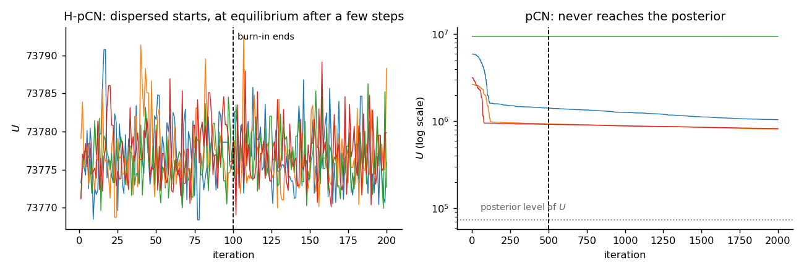
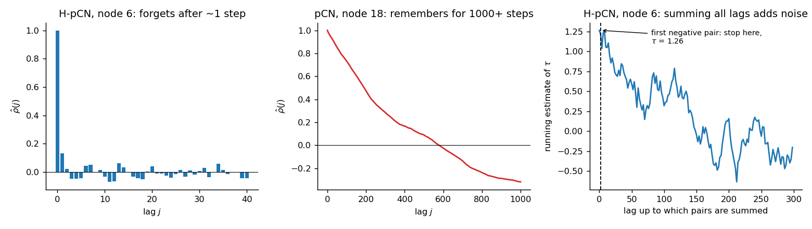
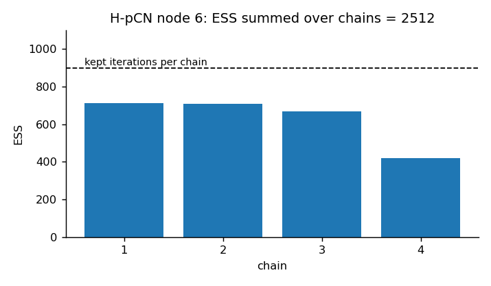
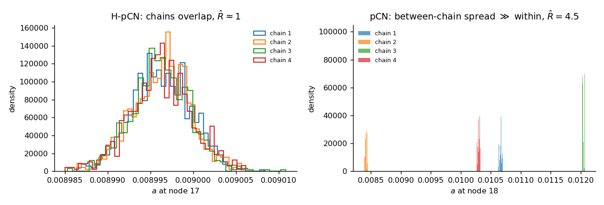
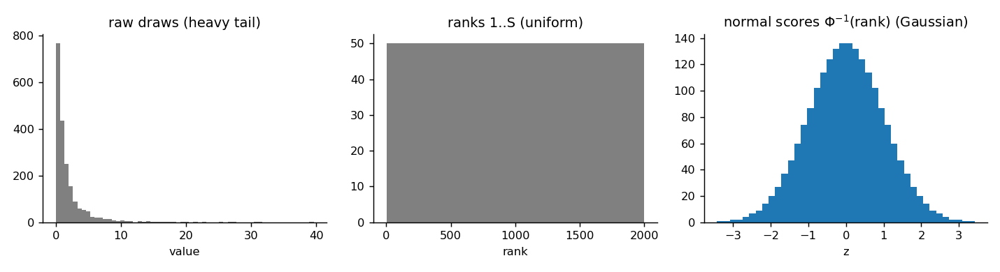
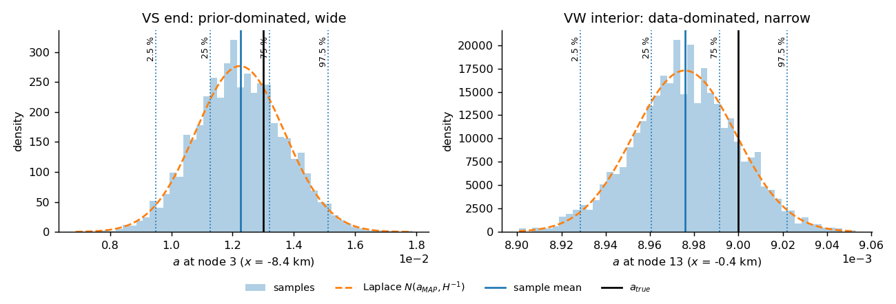
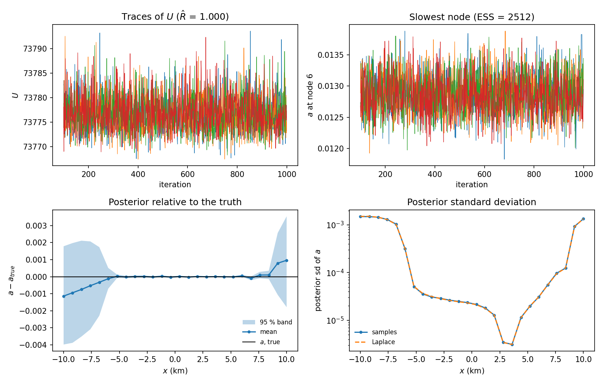
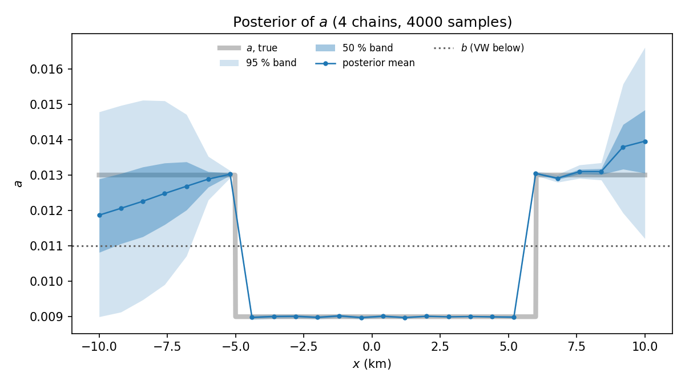

# How `diagnostic_reference.py` works

A walk through [diagnostic_reference.py](../diagnostic_reference.py), section by section, with figures made from our own chains: four H-pCN chains and four plain pCN chains, m = 36, inverse crime. [make_figures.py](make_figures.py) regenerates the figures.

The script answers the three questions of Sec. 4.6 of the script:

1. **Has the chain forgotten its start?** Burn-in, trace plots, R̂.
2. **How many independent samples is it worth?** Autocorrelation, ESS.
3. **Does it sample the right posterior?** The comparison with the Laplace approximation and with a_true. (The real verification is the Gaussian test in `test_pcn_gaussian.m`.)

---

## 1. Imports and the course code (lines 12–21)

```python
import fault  # also puts the course code on the path
from samplers import ess, rank_rhat
```

- **`fault.py`** holds the fault geometry: the 26 node positions `fault.x` on [−10, 10] km, the true step profile `fault.a_true(x)`, and b = 0.011. Importing it also adds the course code folder to `sys.path`.
- **`ess` and `rank_rhat`** come from the course's `samplers.py`, so we use exactly the estimators the script describes.

## 2. Loading the chains: `load_chains` (lines 24–34)

Each MATLAB run saved a struct `chain` in its own `.mat` file. `load_chains` reads all files that match a pattern, e.g. `hpcn_..._seed*.mat`, and stacks them into arrays:

```python
runs = [loadmat(f, squeeze_me=True, struct_as_record=False) for f in files]
```

- **`squeeze_me=True`** removes MATLAB's extra dimensions: a 1×1000 vector becomes a 1000-vector.
- **`struct_as_record=False`** turns a MATLAB struct into a Python object with attributes, so `chain.a` in MATLAB becomes `r["chain"].a` in Python.

```python
n = min(r["chain"].a.shape[1] for r in runs)          # cut all chains to the shortest
A = np.stack([r["chain"].a[:, :n].T for r in runs])   # (chains, iterations, m_p)
U = np.stack([r["chain"].U[:n] for r in runs])        # (chains, iterations)
```

MATLAB stores the samples as columns, `a` with shape (m_p, nIter). The `.T` turns each chain into rows, and `np.stack` puts the chains on top of each other:

```
A[c, k, i]  =  value of a at node i, in iteration k, of chain c

              node i →
           ┌─────────────────┐
 chain 0   │ iteration 0     │
           │ iteration 1     │
           │ ...             │
           └─────────────────┘
 chain 1   ┌─────────────────┐
           │ ...             │       shape (C, N, m_p) = (4, 1000, 26) for H-pCN
```

The chains are cut to the shortest so that the stack is rectangular. This only matters if a run was stopped early.

`n_adapt` is read from `chain.opts.nAdapt`. For pCN those are the Robbins–Monro iterations, which must be discarded.

## 3. Burn-in (lines 37–45)

```python
if burn_in is None:
    burn_in = max(n_adapt, N // 10)
A, U, acc = A[:, burn_in:], U[:, burn_in:], acc[:, burn_in:]
```

The first iterations still remember the starting point, so they are dropped. The default is the adaptation phase or 10 % of the chain, whichever is longer. The traces of U show whether that's enough:



- **Left, H-pCN:** the four chains start at different points (Laplace draws with doubled spread). With s = 1 they are in the posterior after a step or two. U fluctuates around its equilibrium level from the beginning, so a burn-in of 100 is generous.
- **Right, pCN:** U drops quickly at first, then crawls. All four chains stay one to two orders of magnitude above the posterior level (dotted line). No burn-in fixes this: the chain has not reached the posterior at all. The dashed line marks the end of the 500 adaptation iterations.

## 4. R̂ and ESS (lines 47–57)

```python
rhat  = np.array([rank_rhat(A[:, :, i]) for i in range(m_p)])
ess_a = np.array([ess(A[:, :, i]) for i in range(m_p)])
rhat_U, ess_U = rank_rhat(U), ess(U)
```

Both are computed separately for every scalar quantity: each of the 26 nodes, and U. `A[:, :, i]` is the (chains × iterations) array for node i. The worst value over all quantities is what counts (Remark 4.21, item 3).

### 4a. Autocorrelation and ESS

Consecutive samples of a Markov chain are correlated, so N samples carry less information than N independent ones. The **autocorrelation** ρ̂(j) measures how similar the chain is to itself j steps later:



- **Left, H-pCN:** ρ̂(1) ≈ 0.13, and from lag 2 on it's noise around 0. The chain forgets almost immediately.
- **Middle, pCN:** ρ̂(j) stays positive for about 600 lags. The chain remembers its state for longer than it has run.

The **integrated autocorrelation time** τ = 1 + 2 Σ ρ(j) counts how many iterations one independent sample costs, and **ESS = N/τ**. The difficulty is that ρ̂(j) is noisy at large lags. Summing all of them adds noise without information:
- **Right panel:** summing all lags makes the running estimate of τ wander off and even go negative.
- **Geyer's rule** (`samplers.iat`) adds the autocorrelations in pairs ρ(2j) + ρ(2j+1) and stops at the first negative pair, which can't happen for the true values of a reversible chain. Here it stops almost immediately and gives τ = 1.26.

**`ess` of a (chains × iterations) array** computes N/τ for each chain separately and adds the results:



The ESS varies noticeably from chain to chain (chain 4: about 420, the others about 700). τ is estimated from a single chain of 900 samples, and that estimate is itself noisy, which is one more reason to run several chains. The sum, 2512, is the ESS of node 6 that the script reports. ESS is capped at N·log₁₀N per chain, a convention from Stan and ArviZ for chains that are "better than independent".

### 4b. R̂: do the chains agree?

ESS treats each chain on its own, so it can't notice that four chains are sampling four different places. R̂ compares the chains with each other:

  R̂ ≈ √( (variance within chains + variance between chain means) / variance within chains )

- **Chains sampling the same distribution:** the means agree, the between-chain term is about 0, and R̂ ≈ 1.
- **Chains stuck in different places:** the between-chain term dominates, and R̂ ≫ 1.



- **Left, H-pCN:** the histograms of the four chains at node 17 lie on top of each other, so R̂ = 1.002.
- **Right, pCN:** four narrow spikes at four different values. Each chain is stuck near its start. The spread between chains is huge compared with the spread within each one, so R̂ = 4.5.

This is exactly the failure a single chain can't reveal: each spike on its own looks like a "converged", very narrow posterior.

**`rank_rhat` adds two refinements** (Vehtari et al. 2021):
1. **Split.** Each chain is cut into halves, giving 8 half-chains. A chain that drifts slowly then disagrees with itself, so R̂ also catches trends within a chain.
2. **Rank normalization.** The values are replaced by their ranks among all samples and mapped to normal scores. R̂ then no longer depends on heavy tails or outliers:



From left to right: whatever the shape of the raw draws, their ranks are uniform, and Φ⁻¹ of the ranks is standard normal. `rank_rhat` also computes R̂ for the "folded" draws |x − median|, which checks whether the chains agree on the spread and not just the centre, and returns the larger of the two.

### 4c. The cost and the pass/fail line

```python
n_solves = C * N   # one forward solve per iteration, burn-in included
print(f"forward solves per effective sample (worst node): {n_solves / ess_a.min():.1f}")
ok = rhat.max() < 1.01 and rhat_U < 1.01 and ess_a.min() > 400 and ess_U > 400
```

- **Cost per effective sample:** the burn-in solves are included, because they had to be paid for too. This is the number to compare between samplers (Remark 4.21, item 5). H-pCN gives 1.6.
- **Pass/fail:** the thresholds R̂ < 1.01 and ESS > 400 are the recommendation in Sec. 4.6.
- **pCN's ESS of 12** is not meaningful. ESS assumes a chain at equilibrium, which pCN isn't, so its 646 solves per effective sample is an underestimate.

## 5. Posterior summaries (lines 59–73)

```python
samples = A.reshape(-1, m_p)     # pool all chains: (C*(N - burn_in), m_p)
mean, sd = samples.mean(axis=0), samples.std(axis=0, ddof=1)
lo, hi = np.percentile(samples, [2.5, 97.5], axis=0)
```

Once the diagnostics pass, all chains are pooled into one set of samples, and every posterior quantity is an average over them. A credible band is made of **percentiles per node**: 95 % of the samples at that node lie between the 2.5 % and the 97.5 % percentile.



These are the histograms of the pooled samples at two nodes:
- **Left, node 3 in the VS region:** wide, about 1e-3, because the prior decides here.
- **Right, node 13 in the VW zone:** about 60× narrower (standard deviation 2.3e-5 against 1.4e-3), because the data decide.

The dotted lines are the percentiles that become the bands in the posterior figure (section 6). The black line is a_true, which lies inside the 95 % range in both.

```python
mcse = sd / np.sqrt(ess_a)   # Monte Carlo error of the posterior mean
```

The **Monte Carlo standard error** is the uncertainty of the *estimated* mean due to having finitely many samples. It works like the standard error σ/√n of an average of independent values, with ESS in place of n. Here it's at most 2 % of a posterior standard deviation, so the estimated means are accurate.

**The coverage line** counts the nodes where a_true lies inside the 95 % band (26 of 26). The nodes are strongly correlated, so this is not 26 independent tests. It's a sanity check, not a coverage test in the sense of Sec. 4.6.

**The Laplace comparison:**

```python
sd_lap = np.sqrt(np.diag(np.linalg.inv(H)))
```

The Laplace approximation is N(a_MAP, H⁻¹). The standard deviation of node i is the square root of the i-th diagonal entry of the **inverse** H⁻¹, not 1/√H_ii. The latter would be the spread of node i with all other nodes held fixed, which is narrower when the nodes are correlated. In the figure above, the dashed Laplace Gaussian lies on top of the histograms at both nodes, and over all nodes the sample standard deviations agree with it to within ±2.3 %.

## 6. The figures (lines 75–118)

**The diagnostics figure** (lines 75–102): the trace of U for all chains (with R̂), the trace of the node with the smallest ESS, the band relative to a_true, and the posterior standard deviation per node with the Laplace values.



Reading it: the traces are stationary noise with all four colours mixed, which is what an equilibrated chain looks like. The bottom-right panel shows on a log scale how strongly the data constrain each node, from about 3e-6 at x ≈ 3 km up to about 1e-3 at the ends.

**The posterior of a** (lines 104–118): the mean with 50 % and 95 % bands, plotted over the true step profile.

```python
lo50, hi50 = np.percentile(samples, [25, 75], axis=0)
xx = np.linspace(fault.X_MIN, fault.X_MAX, 1001)        # fine grid, so the step is drawn sharp
ax.plot(xx, fault.a_true(xx), color="0.75", lw=4, zorder=0)   # zorder=0: behind everything
```



**`name` and the file names** (line 99) are taken from the first chain file with `_seed1.mat` removed, so all chains of a run share one figure name.

## 7. Running it (lines 121–122)

```
python diagnostic_reference.py "../results/hpcn_m36_eta0.02_s1_laplace_seed*.mat"        # default burn-in
python diagnostic_reference.py "../results/pcn_m36_eta0.02_prior_seed*.mat" 800          # burn-in 800
```

The quotes matter: without them the shell expands the `*` before Python sees it.
